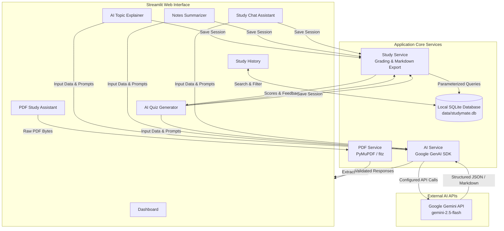

# StudyMate AI — AI Smart Study Assistant

[](https://www.python.org/)
[](https://streamlit.io/)
[](https://aistudio.google.com/)
[](https://docs.pytest.org/)
[](LICENSE)

An intelligent, academically grounded study companion designed for undergraduate engineering students. Built with **Python**, **Streamlit**, and the official **Google GenAI SDK** for Gemini models, with offline-first persistence powered by **SQLite** and PDF extraction via **PyMuPDF**.

---

## 📌 Academic Project Metadata

| Field | Detail |
| :--- | :--- |
| **Student Name** | **Kendre Om** |
| **Institution** | **Sreenidhi University** |
| **Section / Class** | **B11** |
| **Program** | Second-Year B.Tech Class Project |
| **Application Name**| **StudyMate AI** |
| **Version** | `1.0.0` |

---

## 📖 Table of Contents

- [Problem Statement](#-problem-statement)
- [Project Objectives](#-project-objectives)
- [Core Features & Status](#-core-features--status)
- [System Architecture & Workflow](#-system-architecture--workflow)
- [Technology Stack](#-technology-stack)
- [Project Directory Structure](#-project-directory-structure)
- [Installation & Setup (Windows)](#-installation--setup-windows)
- [Running the Application](#-running-the-application)
- [Automated Testing](#-automated-testing)
- [Security & Privacy](#-security--privacy)
- [Known Limitations & Future Scope](#-known-limitations--future-scope)

---

## ❗ Problem Statement

University engineering students regularly face:
1. **Dense Academic Textbooks & Lecture Slides**: Long, jargon-heavy syllabi that are time-consuming to parse before exams.
2. **One-Size-Fits-All Explanations**: Traditional online resources often lack progressive difficulty levels (from beginner analogies to rigorous technical details).
3. **Passive Reading vs. Active Recall**: Students read notes passively without immediate feedback on conceptual comprehension.
4. **Scattered Study Sessions**: Notes, questions, and revision summaries are often lost between browser tabs without structured local persistence.

---

## 🎯 Project Objectives

- **Demystify Complex Engineering Concepts**: Generate multi-tiered explanations (Beginner, Intermediate, Advanced) with concrete analogies, code snippets, and key exam takeaways.
- **Synthesize Lecture Notes**: Condense lengthy lecture transcripts into executive overviews or high-yield bullet points.
- **Foster Active Recall**: Generate verified multiple-choice practice quizzes using structured JSON schemas, accompanied by automated grading and pedagogical explanations.
- **Context-Grounded Assistance**: Enable students to upload textbook PDFs and converse with an AI tutor that prioritizes verified source text and transparently indicates when info is missing.
- **Zero-Cloud-Leak Persistence**: Preserve all study records in an indexed, local SQLite database without requiring external cloud accounts.

---

## 🌟 Core Features & Status

| Feature | Description | Implementation Status | Test Status |
| :--- | :--- | :---: | :---: |
| **🏠 Dashboard** | Interactive overview with module cards, student info, and genuine SQLite study stats. | ✅ Implemented | ✅ Verified |
| **💡 AI Topic Explainer** | Multi-level (Beginner / Intermediate / Advanced) and variable length concept breakdown. | ✅ Implemented | ✅ Mock & Unit Tested |
| **📝 Notes Summarizer** | Executive overviews, detailed breakdowns, or high-yield exam revision points. | ✅ Implemented | ✅ Unit Tested |
| **🎯 AI Quiz Generator** | Structured MCQs (4 options, single answer key, explanations) with automated scoring. | ✅ Implemented | ✅ Tested (JSON & Grading) |
| **💬 Study Chat Assistant** | Multi-turn study dialogue with active PDF context grounding and response saving. | ✅ Implemented | ✅ Unit Tested |
| **📄 PDF Study Assistant** | PyMuPDF text extraction with size limits (15 MB), scanned doc detection, and safety. | ✅ Implemented | ✅ Tested (Valid, Empty, Scanned) |
| **📚 Study History** | Local SQLite storage with full-text search, category filtering, export, and deletion. | ✅ Implemented | ✅ Database Suite Tested |

---

## 🏗️ System Architecture & Workflow



---

## 💻 Technology Stack

- **Application Logic**: Python 3.13+
- **Frontend / Web UI**: Streamlit 1.40+ (Vanilla CSS styling, no heavy UI framework dependencies)
- **AI Integration**: Google's official `google-genai` Python SDK (`client.models.generate_content`)
- **Configurable Models**: `gemini-2.5-flash` (default), configurable via `GEMINI_MODEL`
- **PDF Text Extraction**: PyMuPDF (`fitz` 1.28+)
- **Local Storage**: SQLite 3 (parameterized queries, zero server overhead)
- **Data Validation & Schemas**: Pydantic v2
- **Environment Configuration**: python-dotenv
- **Testing Framework**: pytest 9.1+

---

## 📁 Project Directory Structure

```text
Ai SMART STUDY ASSISTANT/
├── app.py                     # Main Streamlit web application & UI routing
├── requirements.txt           # Project dependencies
├── README.md                  # Comprehensive documentation
├── pytest.ini                 # Pytest configuration (pythonpath = .)
├── .env.example               # Environment variables template
├── .gitignore                 # Excludes secrets, databases, venvs, and temp files
├── .streamlit/
│   └── config.toml            # Academic color theme & server configuration
├── src/
│   ├── __init__.py            # Package initializer
│   ├── ai_service.py          # Gemini API wrapper with structured JSON output
│   ├── pdf_service.py         # PyMuPDF extractor with scanned document detection
│   ├── database.py            # SQLite database schema, queries, and history manager
│   └── study_service.py       # Quiz grading logic, validation, and session exports
├── tests/
│   ├── test_ai_service.py     # AI service mock tests & JSON parsing tests
│   ├── test_database.py       # SQLite CRUD & search/filter test suite
│   ├── test_pdf_service.py    # PDF extraction, header, and size limit tests
│   └── test_study_service.py  # Business logic & quiz scoring tests
└── data/
    └── .gitkeep               # Directory for local SQLite file (git-ignored)
```

---

## 🚀 Installation & Setup (Windows)

### 1. Prerequisites
- **Python 3.10+** (Python 3.13 recommended). Check with:
  ```powershell
  python --version
  ```
- **Git** installed on your system.

### 2. Open Terminal in Workspace
Navigate to your project directory in PowerShell:
```powershell
cd "c:\Users\kendr\OneDrive\Documents\Desktop\Ai SMART STUDY ASSISTANT"
```

### 3. Create and Activate Virtual Environment
```powershell
# Create virtual environment
python -m venv .venv

# Activate virtual environment
.\.venv\Scripts\Activate.ps1
```
*(If you see an execution policy error, run `Set-ExecutionPolicy -Scope Process -ExecutionPolicy Bypass` and re-activate).*

### 4. Install Dependencies
```powershell
pip install -r requirements.txt
```

### 5. Configure Your Gemini API Key
1. Get a free API key from [Google AI Studio](https://aistudio.google.com/).
2. Copy the example configuration file:
   ```powershell
   copy .env.example .env
   ```
3. Open `.env` in any text editor and paste your API key:
   ```env
   GEMINI_API_KEY=AIzaSy...YourKeyHere
   GEMINI_MODEL=gemini-2.5-flash
   DATABASE_PATH=data/studymate.db
   ```
*(You can also input your API key directly inside the app sidebar at runtime without saving it to disk).*

---

## ▶️ Running the Application

To launch StudyMate AI in your web browser:
```powershell
streamlit run app.py
```

The application will launch automatically at:
```text
http://localhost:8501
```

---

## 🧪 Automated Testing

The project includes an automated test suite with **23 test cases** verifying all database operations, PDF security, input validations, structured JSON parsing, and AI error handling using unit mocks (no API key required).

Run the tests using pytest:
```powershell
pytest -v
```

Expected output:
```text
tests/test_ai_service.py::test_missing_api_key_raises_value_error PASSED
tests/test_ai_service.py::test_parse_quiz_json_clean PASSED
tests/test_ai_service.py::test_parse_quiz_json_markdown_wrapped PASSED
tests/test_ai_service.py::test_parse_quiz_json_malformed PASSED
tests/test_ai_service.py::test_sanitize_error_protects_key PASSED
tests/test_ai_service.py::test_explain_topic_with_mock_client PASSED
tests/test_database.py::test_init_db PASSED
tests/test_database.py::test_add_and_retrieve_history PASSED
tests/test_database.py::test_get_history_search_and_filter PASSED
tests/test_database.py::test_get_history_by_id PASSED
tests/test_database.py::test_delete_history_entry PASSED
tests/test_database.py::test_clear_all_history PASSED
tests/test_database.py::test_history_stats PASSED
tests/test_pdf_service.py::test_validate_pdf_size_empty PASSED
tests/test_pdf_service.py::test_validate_pdf_size_too_large PASSED
tests/test_pdf_service.py::test_extract_invalid_pdf_header PASSED
tests/test_pdf_service.py::test_extract_valid_pdf_text PASSED
tests/test_pdf_service.py::test_scanned_pdf_detection PASSED
tests/test_pdf_service.py::test_chunk_text_utility PASSED
tests/test_study_service.py::test_validate_input_length PASSED
tests/test_study_service.py::test_grade_quiz PASSED
tests/test_study_service.py::test_format_quiz_markdown PASSED
tests/test_study_service.py::test_save_study_session PASSED

============================= 23 passed in 1.45s ==============================
```

---

## 🔒 Security & Privacy

- **Zero Secret Exposure**: `.gitignore` strictly excludes `.env`, `*.db`, uploaded PDFs, and virtual environments.
- **Key Masking**: The AI service includes regex-based error sanitization (`_sanitize_error`) that strips any detected API key patterns from error traces.
- **Parameterized SQL**: All database operations use parameterized queries (`?`) to prevent SQL injection vulnerabilities.
- **In-Memory File Processing**: Uploaded PDF files are processed as in-memory streams via PyMuPDF and never permanently written to unmanaged disk locations.
- **Local Isolation**: SQLite records stay on the local machine and are never transmitted to cloud analytics servers.

---

## 🔮 Known Limitations & Future Scope

### Current Limitations
1. **Scanned PDF OCR**: PyMuPDF extracts machine-encoded text only. Scanned or image-only documents are flagged with a user warning since OCR (e.g., Tesseract) is omitted to avoid heavy native binary dependencies.
2. **Local Machine Scope**: SQLite history does not synchronize across separate computers or mobile devices.

### Planned Enhancements
- **Formula & LaTeX Rendering**: Native KaTeX / MathJax rendering for complex engineering equations.
- **Flashcard Deck Generator**: Spaced-repetition (Anki-compatible `.apkg` or CSV export) from extracted summaries.
- **Voice Study Mode**: Text-to-speech integration using Gemini's native audio capabilities for auditory learners.
- **Collaborative Study Rooms**: Optional multi-user peer quizzing over WebSockets.

---

## 👨‍🎓 Author & Academic Credits

- **Developer**: Kendre Om
- **Institution**: Sreenidhi University
- **Section**: B11
- **Course**: B.Tech Computer Science / Engineering — Second Year
- **Instructor / Evaluator Guidance**: Department of Computer Science & Engineering
